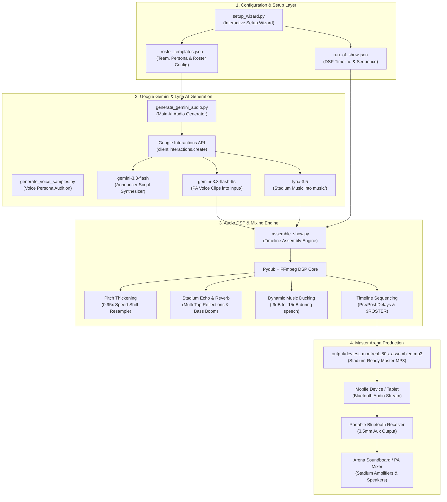
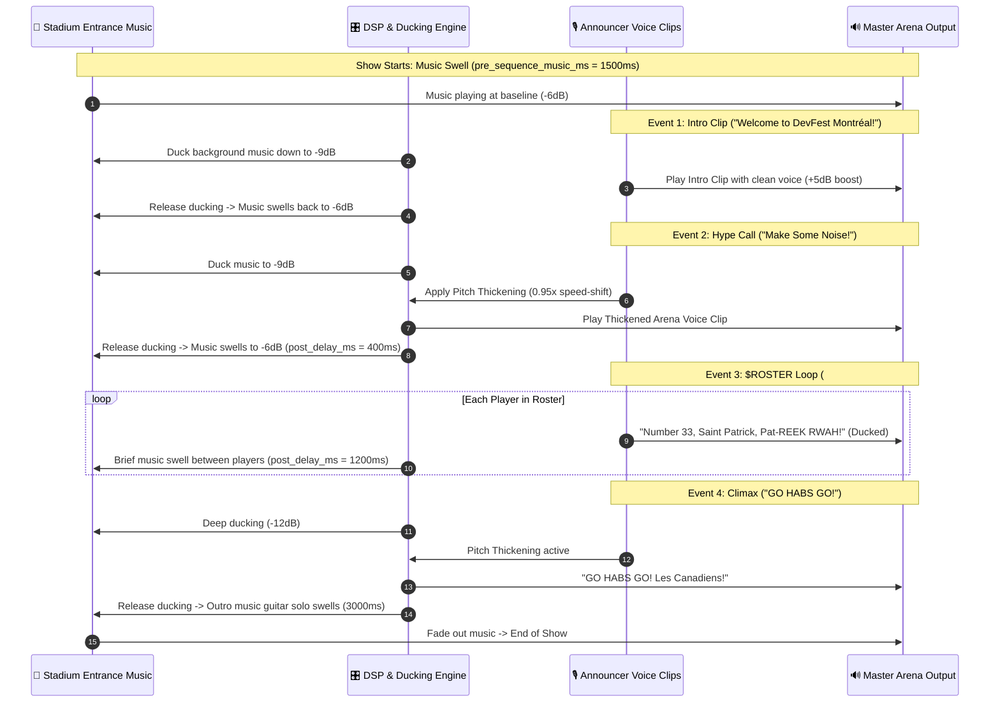

# 🚀 TeamHypeAI - Automated Sports Stadium Audio Announcements

An automated Python pipeline and proof-of-concept suite designed to create stadium-quality audio introductions and announcements for youth sports teams, powered **exclusively by Google Gemini and Lyria AI models**.

TeamHypeAI synthesizes high-energy arena PA voice clips, polishes announcer scripts, generates royalty-free stadium entrance music, and mixes them over ducked background tracks with voice pitch-shifting ("thickening") and precise timing.

---

## 🏒 DevFest Montreal 80s Retro Demo Showcase

This project was built as a live proof-of-concept demo presented at **DevFest Montreal** to showcase the real-world capabilities of Google's latest multimodal and audio models in an engaging, easy-to-follow, and extensible format:

- **1986 Stanley Cup Champions Montreal Canadiens Theme**: The sample roster showcases the legendary 1986 Montreal Canadiens roster (#24 Chris Chelios, #26 Mats Naslund, #19 Larry Robinson, #23 Bob Gainey, and #33 Patrick Roy). It demonstrates regional Francophone pronunciation guides (e.g., *"Pat-REEK RWAH"*, *"Mohn-ray-AL"*) and celebrated Montreal Forum bilingual hockey phrasing (*"Faites du bruit, make some noise!"*, *"Vos Canadiens de Montréal"*).
- **1980s Retro Arena Rock Entrance Music**: Matching the DevFest Montreal 80s retro conference theme, the stadium entrance track is generated with Google Lyria AI using prompts featuring driving analog synthesizers, punchy gated reverb drums, and screaming electric guitar solos.
- **Extensible & Adaptable**: While styled for DevFest Montreal, TeamHypeAI is fully configurable for any local minor hockey team, soccer club, little league baseball squad, or community event.

---

## 🎤 DevFest Montreal Demo & Presentation Slides

This project was showcased at **DevFest Montreal**:

- 📺 **Presentation Slides**: *[Link to DevFest Montreal Slides - Coming Soon]*
- 🏒 **Live Demo Walkthrough / Video**: *[Link to Session Recording / Demo - Coming Soon]*

---

## 🤝 Contributing & Open Source Community

We encourage forks, community collaboration, and open-source contributions!

- 🍴 **Fork & Adapt**: Fork the repository and customize it for your local sports teams, school clubs, or developer conferences.
- 💡 **Open an Issue**: Found a bug or have an idea for a new sport preset or announcer persona? Open a [GitHub Issue](https://github.com/aitalian/team-hype-ai/issues).
- 🚀 **Submit a Pull Request**: Pull requests are welcome! Whether adding support for new audio effects, improving CLI ergonomics, or adding roster templates, please submit a [Pull Request](https://github.com/aitalian/team-hype-ai/pulls).

---

## 📐 System Architecture & Audio Pipeline

The diagram below illustrates the end-to-end dataflow of TeamHypeAI: from initial interactive configuration and AI model synthesis via the Google Interactions API, through local DSP audio mixing with Pydub and FFmpeg, to arena Bluetooth soundboard playback.



### Audio DSP Mixing Sequence Diagram
The sequence below illustrates how background music ducking, pre/post delays, voice thickening, and `$ROSTER` macro expansion are dynamically orchestrated across the playback timeline:



---

## 🌟 Key Features

- **Google Gemini & Lyria AI Audio Stack**:
  - **Script Synthesis**: `gemini-3.8-flash` enhances raw roster entries into UPPERCASE-emphasized stadium announcements with authentic phonetics and tone cues.
  - **Text-to-Speech Engine**: `gemini-3.8-flash-tts` generates high-energy PA voice clips using prebuilt personas (`Puck`, `Charon`, `Kore`, `Fenrir`, `Aoede`) and native `types.SpeechMetadata` with sustained speech style (`speech_metadata.style`) and point-in-time inline tags (`<short pause>`).
  - **Stadium Entrance Music**: `lyria-3.5` synthesizes loopable, pure-instrumental entrance music tracks (strictly NO vocals or lyrics).
- **Google Interactions API Standard**: Native integration with Google's preferred June 2026 **Interactions API** (`client.interactions.create`), with automatic backwards compatibility (`--legacy-api`) and auto-fallback.
- **Dynamic Platform Auto-Routing**: Automatically routes to **Google AI Studio** for AI Studio-exclusive models (like `lyria-3.5`) or **Google Cloud Vertex AI** for enterprise workloads, seamlessly overriding `.env` defaults.
- **Free Tier Quota Optimization**: High-efficiency request batching (batched LLM script enhancement and silence-sliced batched TTS) reduces API requests from ~44 down to **2–3 requests per team run**.
- **Dynamic Rate Limit Parsing**: Automatically parses recommended wait times (e.g. `'retryDelay': '6429s'`) from 429 `RESOURCE_EXHAUSTED` responses to sleep for the exact duration needed.
- **Audio Engineering & DSP**:
  - Stadium PA echo, multi-tap acoustic reverb (`subtle`, `arena`, `stadium`, `coliseum`), and low-end bass boom (<220Hz chest resonance).
  - Voice pitch thickening (0.95x speed-shifted and resampled for stadium resonance).
  - Dynamic background music ducking (drops `-8dB` to `-15dB` during announcements).
  - Peak and clip volume normalization.
- **Drop-in Custom Audio**: Place custom MP3 background tracks in `music/` or pre-recorded clips/horns in `input/` to bypass AI generation for selected items.
- **Arena Hardware Playbook**: Stream assembled audio from your phone/tablet over Bluetooth to the arena PA soundboard aux input.

---

## 🧭 Where to Start: Recommended End-to-End Workflow

For both new users and seasoned producers, we recommend following this clear 5-step journey:

```text
[Step 1: setup_wizard.py] ──► [Step 2: generate_voice_samples.py] ──► [Step 3: generate_gemini_audio.py]
      (Interactive Setup)             (Audition Announcers)                  (Generate Voice & Music)
                                                                                       │
                                                                                       ▼
[Step 5: Arena PA Playback] ◄───────────────────────────────────────── [Step 4: assemble_show.py]
    (Live Game-Day Impact)                                                   (Audio DSP Mixing Engine)
```

### Step 1: Run the Interactive Setup Wizard (Start Here!)
Launch [`setup_wizard.py`](file:///Users/aitalian/Sandbox/gitlab/aitalian/devfestmtl26-teamhypeai/setup_wizard.py). The wizard detects any existing configuration files (`roster_templates.json` and `run_of_show.json`) and loads their values as **implied defaults**. You can press **Enter** to keep existing settings or enter new values for your team:
```bash
python setup_wizard.py
```
*Outputs: `roster_templates_<team>.json` and `run_of_show_<team>.json`.*

### Step 2 (Optional): Audition Voice Personas
Before generating audio for an entire team roster, audition Google Gemini's curated high-energy stadium voices (`Puck`, `Charon`, `Kore`, `Fenrir`, `Aoede`) in `samples/`:
```bash
python generate_voice_samples.py --featured-only
```

### Step 3: Generate AI Voice Clips & Entrance Music
Run [`generate_gemini_audio.py`](file:///Users/aitalian/Sandbox/gitlab/aitalian/devfestmtl26-teamhypeai/generate_gemini_audio.py) using your roster template. First, run a **dry-run** to preview generated announcer dialogue and verify estimated API token costs:
```bash
# Preview prompts and cost estimate without calling Google APIs:
python generate_gemini_audio.py -r roster_templates.json --dry-run

# Generate audio files (saves voice clips in input/ and entrance music in music/):
python generate_gemini_audio.py -r roster_templates.json
```

### Step 4: Assemble the Master Stadium Audio Mix
Stitch and master your voice clips, sound effects, and entrance music using [`assemble_show.py`](file:///Users/aitalian/Sandbox/gitlab/aitalian/devfestmtl26-teamhypeai/assemble_show.py):
```bash
python assemble_show.py -c run_of_show.json
```
*Outputs: Broadcast-ready master MP3 in `output/` (e.g., `output/devfest_montreal_80s_assembled.mp3`).*

### Step 5: Game-Day Arena Playback
Copy or stream the assembled MP3 from your phone or tablet to the arena soundboard using a Bluetooth auxiliary receiver.

---

## 🛠️ Comprehensive Utility Scripts Reference

TeamHypeAI provides 6 dedicated CLI utilities designed for distinct stages of the sports audio production lifecycle:

### 1. `setup_wizard.py` - Interactive Team Onboarding Wizard
- **What it is & Why**: An interactive terminal wizard that guides first-time users through entering team identity, announcer personas, voice selection, AI models, background music prompts, intro clips, and player rosters. It prevents JSON formatting errors and eliminates boilerplate.
- **Key Feature**: Reads existing `roster_templates.json` and `run_of_show.json` files and presents their values as implied defaults in brackets `[...]`. Pressing Enter accepts the default.
- **Usage**:
  ```bash
  python setup_wizard.py
  ```

---

### 2. `generate_voice_samples.py` - Announcer Voice Audition Generator
- **What it is & Why**: Generates short sample audio clips for prebuilt Google Gemini voice personas and saves them in the `samples/` directory. It allows you to audition different voice profiles and delivery styles before running full roster generation.
- **Key CLI Flags**:
  - `--featured-only`: Restricts generation to core stadium announcer personas (`Puck`, `Charon`, `Kore`, `Fenrir`, `Aoede`).
  - `--speech-style "..."`: Sets turn-level delivery style & nuance (e.g. `"excitedly, fast-paced"` or `"shouting, hype"`).
  - `--regional-accent "..."`: Tests regional accent inflection (e.g. `"French Canadian"`).
  - `--dry-run`: Previews dialogue and cost projection without calling Google APIs.
  - `--force`: Regenerates cached sample clips.
- **Examples**:
  ```bash
  # Audition featured voices with default high-energy delivery:
  python generate_voice_samples.py --featured-only

  # Audition voices with aggressive stadium shouting:
  python generate_voice_samples.py --featured-only --speech-style "shouting, high-energy"

  # Preview prompts in dry-run mode:
  python generate_voice_samples.py --dry-run
  ```

---

### 3. `generate_gemini_audio.py` - Main AI Speech & Music Generator
- **What it is & Why**: The core generation engine that contacts Google Gemini and Lyria APIs to synthesize PA voice announcements into `input/` and stadium entrance music into `music/`. It handles token estimation, quota batching, rate-limit retries, and platform auto-routing.
- **Key CLI Flags**:
  - `-r`, `--roster`: Path to roster template JSON (default: `roster_templates.json`).
  - `--dry-run`: Previews prompts, dialogue, batch breakdown, and estimated API charges.
  - `--speech-style "..."`: Overrides default announcer delivery style (alias: `--style`, `--audio-tags`).
  - `--regional-accent "..."`: Overrides regional accent guidance.
  - `--aistudio` / `--vertexai`: Forces Google AI Studio or Vertex AI platform (auto-routed by default).
  - `--legacy-api`: Opts into legacy `generateContent` instead of the Interactions API.
  - `--batch-script` / `--no-batch-script`: Toggles batched LLM script enhancement (enabled by default).
  - `--batch-tts` / `--no-batch-tts`: Toggles batched TTS silence-sliced generation (enabled by default).
  - `--skip-music`: Generates voice clips only.
  - `--skip-voice`: Generates background music only.
  - `-f`, `--force`: Regenerates existing cached audio files.
  - `-y`, `--yes`: Automatically accepts estimated cost prompt.
- **Examples**:
  ```bash
  # Preview dialogue and cost before making API calls:
  python generate_gemini_audio.py --dry-run

  # Generate entire Montreal Canadiens demo assets:
  python generate_gemini_audio.py -r roster_templates.json

  # Generate voice clips only for a custom team:
  python generate_gemini_audio.py -r roster_templates_eagles.json --skip-music
  ```

---

### 4. `assemble_show.py` - Audio DSP Mixer & Show Stitching Engine
- **What it is & Why**: An audio engineering engine powered by Pydub and FFmpeg. It reads `run_of_show.json`, sequences audio events, applies pitch thickening, layers multi-tap stadium PA echo/reverb and bass boom, dynamically ducks background music during speech announcements, normalizes audio levels, and exports the master MP3.
- **Key CLI Flags**:
  - `-c`, `--config`: Path to Run of Show JSON config (default: `run_of_show.json`).
  - `-r`, `--roster-config`: Overrides roster template file used for `$ROSTER` macro expansion.
  - `--reverb {none,subtle,arena,stadium,coliseum}`: Overrides stadium echo/reverb preset across voice announcements.
  - `--no-reverb`: Disables all stadium echo/reverb effects for a dry mix.
  - `-f`, `--force`: Forces re-assembly even if target output mix file already exists.
- **Examples**:
  ```bash
  # Assemble default run of show (with configured stadium reverb):
  python assemble_show.py -c run_of_show.json

  # Force re-assembly with massive coliseum reverb override:
  python assemble_show.py -c run_of_show.json --reverb coliseum -f
  ```

---

### 5. `update_cost_rates.py` - Model & Pricing Rate Card Tracker
- **What it is & Why**: Audits and synchronizes model rate cards and platform availability booleans (`ai_studio` vs `vertex_ai`) in [`config/cost_rates.json`](file:///Users/aitalian/Sandbox/gitlab/aitalian/devfestmtl26-teamhypeai/config/cost_rates.json) against official Google Cloud and Google AI Studio documentation.
- **Key CLI Flags**:
  - `--check`: Audits local configuration and reports discrepancies without modifying files.
  - `--update`: Updates `config/cost_rates.json` with latest rates and platform matrices.
- **Examples**:
  ```bash
  # Audit current pricing rates:
  python update_cost_rates.py --check
  ```

---

### 6. `update_gemini_voices.py` - Gemini TTS Voice Catalog Tracker
- **What it is & Why**: Queries upstream Google Gemini TTS voice catalogs, applies strict high-energy sports announcer filtering, and updates [`config/gemini_voices.json`](file:///Users/aitalian/Sandbox/gitlab/aitalian/devfestmtl26-teamhypeai/config/gemini_voices.json).
- **Key CLI Flags**:
  - `--check`: Audits discovered voices against local configuration.
  - `--update`: Updates `config/gemini_voices.json` with newly qualified announcer personas.
- **Examples**:
  ```bash
  # Audit stadium voice catalog:
  python update_gemini_voices.py --check
  ```

---

## ⚙️ Configuration Files & Fine-Tuning Guide

TeamHypeAI separates team identity and voice configuration (`roster_templates.json`) from audio timeline sequencing and DSP mixing (`run_of_show.json`).

### 1. Fine-Tuning Roster Templates (`roster_templates.json`)

The roster template defines who your team is, how the announcer should speak, how player names are pronounced, and what music should be composed:

```json
{
  "team_name": "Montreal Canadiens",
  "team_mascot": "Canadiens",
  "models": {
    "api_engine": "interactions",
    "tts_model": "gemini-3.8-flash-tts",
    "llm_model": "gemini-3.8-flash",
    "music_model": "lyria-3.5",
    "enhance_scripts": "auto",
    "batch_script_enhancement": true,
    "batch_tts": true,
    "tts_batch_size": 10
  },
  "announcer_persona": {
    "voice_name": "Puck",
    "speech_style": "excitedly, fast-paced arena rock announcer with a Quebec French Canadian accent on French names and places",
    "prompt_prefix": "Say rapidly with intense, fast-paced stadium PA announcer energy: ",
    "theme_context": "1980s retro arena rock stadium theme for DevFest Montreal...",
    "regional_accent": "French Canadian",
    "accent_guidance": "Authentic Quebec French Canadian pronunciation on Francophone names"
  },
  "player_template": "Number {number}, <short pause> {name}!",
  "roster": [
    {
      "number": "33",
      "name": "Patrick Roy",
      "phonetic": "Pat-REEK RWAH",
      "custom_intro": "Stopping all the pucks, rookie sensation in net, <short pause> wearing number {number}, Saint Patrick, {phonetic}!",
      "speech_style": "excitedly, very fast Quebec arena announcer",
      "post_delay_ms": 1500
    }
  ],
  "intro_clips": [
    {
      "filename": "Welcome to DevFest.wav",
      "text": "Welcome to DevFest Montréal! Step back to 1986!",
      "phonetic": "Welcome to Dev-Fest Mohn-ray-AL! <short pause> Step back to 1986!",
      "speech_style": "excitedly, high enthusiasm with French Canadian inflection"
    }
  ],
  "music": {
    "filename": "background_music-lyria3.5-devfestmtl",
    "prompt": "High-energy 1980s retro arena rock sports entrance track featuring driving analog synthesizers, punchy gated reverb electronic drums, screaming electric guitar solos and power chords, strictly NO vocals.",
    "duration_seconds": 30,
    "loopable": true
  }
}
```

#### Fine-Tuning Tips for Roster Configuration:
1. **Phonetic Pronunciation Respellings (`phonetic`)**: Standard TTS engines often struggle with regional or foreign names. Use hyphens and capital letters for stress:
   - *Patrick Roy* -> `"Pat-REEK RWAH"`
   - *Mats Naslund* -> `"Mats NAHZ-lund"`
   - *Larry Robinson* -> `"LAIR-ee ROB-in-sun"`
   - *Jersey Number Respellings (`phonetic_number`)*: For double digits that need clear cadence, use `"Six. Sev-uhn."` for #67.
2. **Sustained Speech Style (`speech_style`) vs Point-in-Time Vocal Tags (`<...>`)**:
   - **Turn-Level Speech Style**: Passed via `announcer_persona.speech_style` or `roster[i].speech_style`. Always use clean descriptive strings without brackets (e.g. `"excitedly, fast-paced"`, `"shouting, hype"`).
   - **Inline Vocal Events**: Placed inside dialogue text using angle brackets (e.g. `<short pause>`, `<cheer>`, `<sigh>`).
3. **Custom Intro Overrides (`custom_intro`)**: Overrides the default `player_template` for individual star players, team captains, or goalies. You can reference `{number}`, `{name}`, and `{phonetic}` macros.
4. **Instrumental Entrance Music Prompts (`music.prompt`)**: To ensure Lyria generates pure instrumental tracks, specify instrument textures (e.g., *driving electric guitars*, *analog synthesizers*, *punchy drums*) and avoid vocal descriptions. TeamHypeAI automatically wraps your prompt with `strictly NO vocals, NO lyrics`.

---

### 2. Fine-Tuning Run of Show (`run_of_show.json`)

The Run of Show config governs the digital audio workstation (DSP) mixing engine, audio levels, ducking curves, and playback sequence:

```json
{
  "settings": {
    "music_folder": "music",
    "music_file": "background_music-lyria3.5-devfestmtl.mp3",
    "music_volume_db": -6,
    "default_ducking_vol_db": -9,
    "default_voice_boost_db": 0,
    "reverb_preset": "stadium",
    "pre_sequence_music_ms": 1500,
    "initial_silence_ms": 0,
    "normalize_output": true,
    "normalize_voice_clips": true,
    "input_folder": "input",
    "output_folder": "output",
    "output_filename": "devfest_montreal_80s_assembled.mp3"
  },
  "sequence": [
    {
      "file": "Welcome to DevFest.wav",
      "ducking": false,
      "pre_delay_ms": 500,
      "post_delay_ms": 400,
      "thicken": false,
      "reverb": "stadium"
    },
    {
      "file": "Make Some Noise.wav",
      "ducking": false,
      "pre_delay_ms": 200,
      "post_delay_ms": 300,
      "thicken": true,
      "reverb": "stadium"
    },
    {
      "file": "$ROSTER",
      "ducking": true,
      "pre_delay_ms": 200,
      "post_delay_ms": 1200,
      "thicken": false,
      "reverb": "stadium"
    },
    {
      "file": "GO HABS GO.wav",
      "ducking": false,
      "pre_delay_ms": 400,
      "post_delay_ms": 3000,
      "thicken": true,
      "reverb": "coliseum"
    }
  ]
}
```

#### Fine-Tuning Tips for Run of Show:
1. **Dynamic Background Ducking (`ducking` & `default_ducking_vol_db`)**:
   - When `ducking: true`, the background entrance music volume is attenuated down to `default_ducking_vol_db` (typically `-9dB` to `-15dB`) while the speech clip plays, ensuring vocal clarity.
   - For high-energy shouting clips over driving rock music, setting ducking to `false` lets the music pump at full energy behind the voice.
2. **The `$ROSTER` Macro**:
   - Placing `{"file": "$ROSTER"}` in `sequence` automatically expands into individual announcement events for every player defined in your roster file, in exact roster order.
   - The `pre_delay_ms`, `post_delay_ms`, `thicken`, and `reverb` defined on `$ROSTER` govern each player announcement (and can be overridden per player in `roster_templates.json`).
3. **Stadium Echo, Reverb & Bass Boom (`reverb` & `settings.reverb_preset`)**:
   - Adds multi-tap acoustic reflections (early slapback + late stadium bowl decay with progressive high-frequency air damping) and sub-220Hz low-end bass warmth so announcements sound loud and booming.
   - Built-in presets: `"subtle"` (indoor gym), `"arena"` (hockey/basketball arena), `"stadium"` (championship stadium PA), `"coliseum"` (massive open-air canyon tail), or `false` / `"none"` (dry, ideal for pre-recorded SFX/crowd cheers).
   - You can also pass a custom dictionary on any event: `{"preset": "stadium", "wet_gain_offset_db": 1.5, "bass_boost_db": 4.0, "tail_ms": 700}`.
4. **Voice Pitch Thickening (`thicken: true`)**:
   - Applies a 0.95x speed-shift resampled back to 44.1kHz. This drops the vocal pitch slightly while preserving duration, giving youth PA announcements the booming, resonant authority of an NHL arena announcer.
5. **Pacing & Timing (`pre_delay_ms`, `post_delay_ms` & `clip_duration_ms`)**:
   - `pre_delay_ms`: Extra milliseconds of music before the voice announcement starts (creates dramatic anticipation).
   - `post_delay_ms`: Milliseconds of music swell after the announcement ends before the next clip starts (allows the crowd to cheer or music beat to drop).
   - `clip_duration_ms`: Trims long SFX or audio clips to a maximum duration in milliseconds.
6. **Smooth Clip Fade-Out & Fade-In (`fade_out_ms` / `fade_in_ms`)**:
   - Use `"fade_out_ms": 1500` (or `"fade_out": true` to apply the default `1500ms` fade) on any clip—especially SFX, organ intros, or crowd cheers—so the tail of the clip smoothly fades into the background music and becomes inaudible instead of cutting off abruptly.
   - Similarly supports `"fade_in_ms": 500` (or `"fade_in": true`) to smoothly ramp a clip's entrance volume.

---

## 🤖 Model Stack & Single Source of Truth References

To adhere to strict **DRY (Don't Repeat Yourself)** principles, all model configurations, rate cards, and voice catalogs are maintained in centralized sources of truth:

| Model | Role | Platform Availability | Details & Documentation |
| :--- | :--- | :--- | :--- |
| **`gemini-3.8-flash`** | Announcer Script Synthesizer | AI Studio & Vertex AI | High-reasoning script polishing and phonetic formatting |
| **`gemini-3.8-flash-tts`** | Text-to-Speech Engine | AI Studio & Vertex AI | Studio-grade stadium speech with structured `speech_metadata` |
| **`lyria-3.5`** | Stadium Music Generator | AI Studio (Exclusive) | High-energy loopable stadium entrance tracks (no vocals) |

### 📌 Single Sources of Truth:
- 📊 **Model Specifications, Availability & Rates**: [`config/cost_rates.json`](file:///Users/aitalian/Sandbox/gitlab/aitalian/devfestmtl26-teamhypeai/config/cost_rates.json)  
  *Audit or update live rates anytime with: `python update_cost_rates.py --check`*
- 🎙️ **Stadium Voice Personas**: [`config/gemini_voices.json`](file:///Users/aitalian/Sandbox/gitlab/aitalian/devfestmtl26-teamhypeai/config/gemini_voices.json)  
  *Curated English high-energy stadium announcers (`Puck`, `Charon`, `Kore`, `Fenrir`, `Aoede`). Audit with: `python update_gemini_voices.py --check`*
- 📖 **Comprehensive Technical Reference**: [`GEMINI.md`](file:///Users/aitalian/Sandbox/gitlab/aitalian/devfestmtl26-teamhypeai/GEMINI.md)  
  *Full technical documentation detailing the Interactions API contract, audio DSP algorithms, regional phonetics, and platform resolution precedence.*

---

## 🎧 Drop-in Custom Audio & Hybrid Workflows

TeamHypeAI allows full flexibility to mix AI-generated audio with custom human-recorded clips or professional tracks:
1. **Custom Music**: Place an audio file at `music/background_music.mp3`. The pipeline automatically skips Lyria generation and mixes your music.
2. **Custom SFX & Goal Horns**: Drop audio files (e.g. `sfx_goal_horn.wav`, `Make Some Noise.wav`) into `input/`. Existing files are preserved and never overwritten unless `--force` is specified.
3. **Hybrid Roster**: Combine AI-generated introductions for player intros with pre-recorded coach clips or team chants.

---

## 📻 Arena Hardware Setup (Live Playbook)

```text
[ Mobile Device (Phone/Tablet) ]
       │ Bluetooth Audio Stream
       ▼
[ Portable Bluetooth Receiver Unit ]
       │ 3.5mm Stereo Aux Cable
       ▼
[ Arena Soundboard Aux Input / Mixer ]
       │ Arena Amplifiers
       ▼
[ Rink Stadium Speakers ]
```

1. **Bluetooth Receiver**: Plug a portable Bluetooth auxiliary receiver (e.g., Anker, Avantree) into the arena soundboard 3.5mm aux input.
2. **Pair & Test**: Pair your phone or tablet hosting the assembled MP3 from `output/`.
3. **Game-Day Trigger**: Play the track as players take the ice for maximum stadium impact!

---

## ⚖️ License & Disclaimers

### License
This project is licensed under the **GNU Affero General Public License v3.0 (GNU AGPLv3)**. See the [LICENSE](LICENSE) file or visit [https://www.gnu.org/licenses/](https://www.gnu.org/licenses/) for details.

### Disclaimers & API Terms
- This project is **not created, maintained, or endorsed by Google LLC**.
- Running this tool requires a Google Gemini API key or Google Cloud account. Users are solely responsible for all API usage, billing, rate limit adherence, and compliance with the [Google Gemini API Terms of Service](https://ai.google.dev/terms) and [Google Cloud Terms of Service](https://cloud.google.com/terms).
